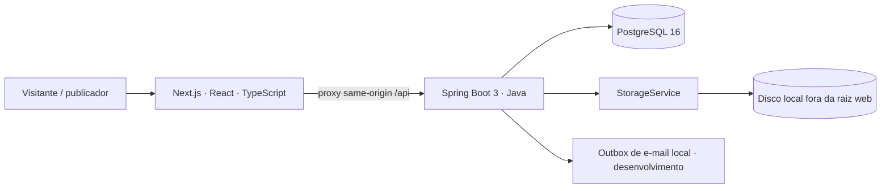

# SciPath

**Plataforma de descoberta e publicação de materiais científicos e acadêmicos.** Estudantes, docentes e pesquisadores podem compartilhar materiais com autoria, categoria e licença visíveis; visitantes podem descobri-los sem criar conta.

> **Status:** MVP em desenvolvimento, para avaliação e testes locais. **Não está hospedado nem pronto para produção.**

## O que já funciona

- Página inicial, descoberta pública, busca textual, filtros e paginação.
- Páginas públicas de material, autor e categoria, com licença e acesso controlado ao PDF.
- Cadastro, login/logout, sessão, edição de perfil e verificação de e-mail para publicar.
- Publicação de PDF até 30 MB, com validação de conteúdo, metadados, taxonomia e licença.
- Área privada para listar, ler, editar, retirar, republicar e excluir materiais próprios.
- Exclusão lógica e expurgo configurável do binário após sete dias; os metadados são preservados.

A evidência funcional e os limites verificados estão em [`docs/qa/aceite-etapa-5.md`](docs/qa/aceite-etapa-5.md). O seed de desenvolvimento contém **dados fictícios sinalizados**; não são conteúdo de usuários nem material para apresentação como real.

## O que não faz / limites conhecidos

- Não há implantação pública, backup com restauração testada, envio real de e-mail, armazenamento S3/MinIO, termos e política de privacidade definitivos ou canal operacional de denúncia.
- Não há revisão por pares, certificação científica, painel administrativo, feed social, recomendações, coleções ou trilhas de aprendizagem.
- A anonimização de metadados após 90 dias permanece uma decisão de privacidade pendente (ADR-0011 §9).
- A aceitação automatizada usa testes de integração e fixtures de API; não substitui leitor de tela real, outro motor de navegador nem teste humano de todas as combinações.

Por isso, o SciPath **não deve ser usado como serviço público** nem ser descrito como pronto para produção (ADR-0007).

## Arquitetura



O armazenamento passa por `StorageService`; o domínio não depende do provedor. Nesta versão, os binários ficam em disco local, fora da raiz pública, e a API decide se cada arquivo pode ser acessado.

## Stack

- **API:** Java 21, Spring Boot 3, Maven e PostgreSQL 16.
- **Web:** Next.js App Router, React, TypeScript e Tailwind CSS.
- **Arquivos:** armazenamento local atrás de `StorageService`.
- **Contrato:** [`contracts/openapi.yaml`](contracts/openapi.yaml).

## Como rodar localmente

Receita verificada para Linux com PostgreSQL 16 nativo (sem Docker). Requer Bash, `make`, Python 3, JDK 21 ou compatível, Node.js **>= 20.9** e acesso administrativo local ao PostgreSQL para o setup inicial.

```bash
git clone <URL-do-repositório> scipath
cd scipath
make doctor
bash infra/db-setup.sh          # cria scipath e gera .env ignorado pelo Git
sudo bash infra/db-test-setup.sh # uma vez; configura/recria somente scipath_test
cd frontend && npm ci && cd ..
make db:migrate
make db:seed:dev                 # opcional: conteúdo fictício, só no banco local
```

`db-test-setup.sh` requer `sudo`, altera a configuração local do `pg_hba` para permitir acesso de teste pelo loopback e **recria `scipath_test`**. Nunca use esse banco para dados pessoais. Não copie `.env` entre máquinas; `db-setup.sh` gera credenciais locais sem imprimi-las.

Inicie cada serviço em um terminal separado:

```bash
# terminal 1 — API em :8080
make api:dev
```

```bash
# terminal 2 — web em :3000
make web:dev
```

Acesse <http://localhost:3000>. Para encerrar, use `Ctrl+C` nos dois terminais. A verificação de e-mail em desenvolvimento grava no outbox local; após cadastrar-se, `make email:outbox` mostra a última mensagem **no seu terminal**. Não compartilhe o link/token de uso único.

## Como rodar os testes

Com `scipath_test` preparado e `frontend/node_modules` instalado:

```bash
MAVEN_OPTS=-Xmx384m make test
make lint
(cd frontend && npm run build)
make contract:check
```

`make lint` regenera os tipos de rota antes do ESLint e do typecheck. `make test` usa o banco de teste e não precisa carregar o `.env`. O aceite E5.10 registrou 267 testes backend sem falhas. Os **aceites por etapa** ficam em [`docs/qa/`](docs/qa/), e o log bruto de execução (que não é versionado) é anexo local — ver [ADR-0012](docs/adr/ADR-0012-evidencia-bruta-fora-do-repositorio.md).

## Escopo e decisões

- [DRS v1.0](assets/raw_files/drs_scipath_v1.0.pdf) — requisitos e critérios de aceite.
- [Visão do produto e escopo do MVP](docs/00-visao.md)
- [Arquitetura](docs/01-arquitetura.md)
- [ADRs](docs/adr/) — decisões técnicas e limites aceitos.
- [OpenAPI](contracts/openapi.yaml) — fronteira entre web e API.
- [Aceites por etapa](docs/qa/) — verificação independente de cada etapa (2 a 5) e do MVP.

## Como foi desenvolvido

O projeto foi conduzido por João Mateus de Sousa com apoio de agentes Hermes (perfis de produto, backend, frontend, QA e gerência), organizados por cards e worktrees. Os agentes foram ferramentas de desenvolvimento; **não fazem parte do produto em execução**. Requisitos, decisões e aceites ficam registrados no DRS, nos ADRs, no contrato e em `docs/qa/`; o log bruto de cada rodada não é versionado ([ADR-0012](docs/adr/ADR-0012-evidencia-bruta-fora-do-repositorio.md)).

## Licença

O código original do SciPath em `backend/`, `frontend/` (exceto fontes de terceiros), `infra/` e `contracts/` está sob **MIT**; consulte [`LICENSE`](LICENSE). Essa licença não cobre `docs/`, o DRS PDF nem arquivos com licença própria. As fontes Google Sans/Google Sans Flex e Roboto Mono são componentes de terceiros sob **SIL Open Font License 1.1**; os avisos estão em [`assets/fonts/`](assets/fonts/) e `frontend/public/fonts/`.
